# More Projects

These projects are in development. App links will be added when they are ready.

  
  
  

  
  
  

  
  
  

  

Project descriptions

- **Food Planner** — Tamil Nadu-focused daily, weekly, and monthly meal planner.
- **FLORENZA** — Interactive 3D plant shopping experience.
- **Ignite** — Fireworker website.
- **The Ascent** — Anime power ranker.
- **EduSync** — Learning Management System (LMS).
- **Pallanguzhi** — Traditional Pallanguzhi game.
- **AI Roadmap** — AI-powered roadmap project.
- **Sangamverse** — Ancient Tamil literature platform.
- **Diskwise** — Automatic file organizer.

