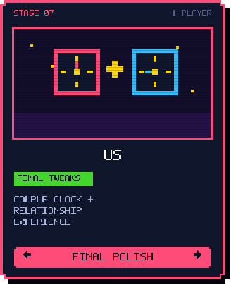
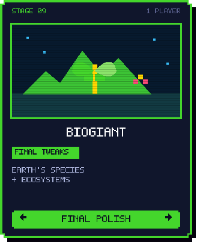
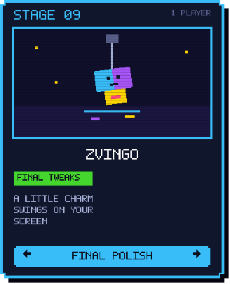
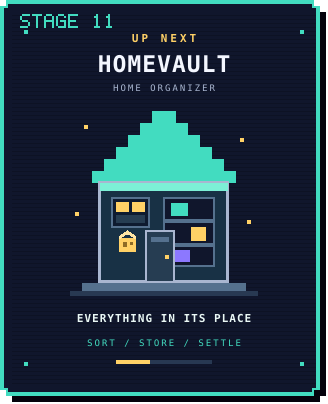

  

<h1 align="center"></h1>

  

  <picture>
    <source media="(max-width: 480px) and (prefers-color-scheme: dark)" srcset="./assets/tech-stack-dark-mobile-v2.svg?v=085697a1ffcc74691524f75f0b51f9d196b6c9ab" />
    <source media="(max-width: 480px) and (prefers-color-scheme: light)" srcset="./assets/tech-stack-light-mobile-v2.svg?v=3b4283c99895c15a366302f8993ed55a5d20ef91" />
    
  </picture>

<h2 align="center">
  <picture>
    <source media="(prefers-color-scheme: dark)" srcset="./assets/featured-projects-heading-dark-v2.svg" />
    
  </picture>
</h2>

<!-- Keep the 6x2 featured grid at twelve cards; additional project art belongs on PROJECTS.md. -->
<!-- Keep the 4x3 featured grid at twelve cards; additional project art belongs on PROJECTS.md. -->

                               <a href="https://github.com/logeshdsgn/logeshdsgn/blob/main/PROJECTS.md"><picture><source media="(prefers-reduced-motion: reduce)" srcset="./assets/cards/locked.svg" /></picture></a>

  

