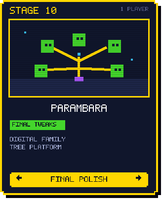

  

<h1 align="center"></h1>

  

  

<h2 align="center">
  <picture>
    <source media="(prefers-color-scheme: dark)" srcset="./assets/featured-projects-heading-dark-v2.svg" />
    
  </picture>
</h2>

<!-- Keep the 6x2 featured grid at twelve cards; additional project art belongs on PROJECTS.md. -->

                 

                 <a href="https://github.com/logeshdsgn/logeshdsgn/blob/main/PROJECTS.md"><picture><source media="(prefers-reduced-motion: reduce)" srcset="./assets/cards/locked.svg" /></picture></a>

  

