  

<h1 align="center"></h1>

  

<h2> TECH STACK</h2>

<picture>
  <source media="(max-width: 600px) and (prefers-color-scheme: dark)" srcset="./assets/tech-stack-dark-mobile.svg" />
  <source media="(max-width: 600px) and (prefers-color-scheme: light)" srcset="./assets/tech-stack-light-mobile.svg" />
  <source media="(prefers-color-scheme: dark)" srcset="./assets/tech-stack-dark.svg" />
  
</picture>

## FEATURED PROJECTS

| **Name** | **Description** | **Link** |
| --- | --- | --- |
| **Prompt Mania** | A curated prompt engineering framework library. | [View](https://logeshdsgn.github.io/prompt_mania/) |
| **Tamil Clock** | An interactive Tamilakam-inspired clock blending traditional timekeeping, astronomy, and Sangam literature. | [View](https://github.com/logeshdsgn/tamil-clock) |

  

